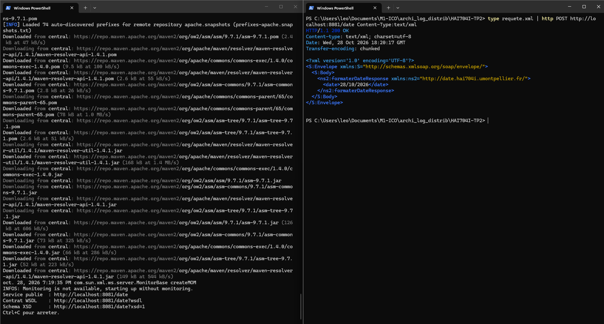
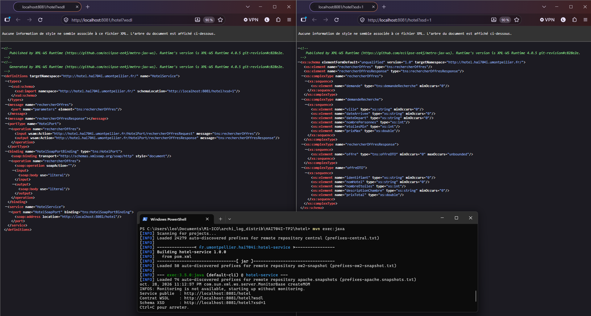
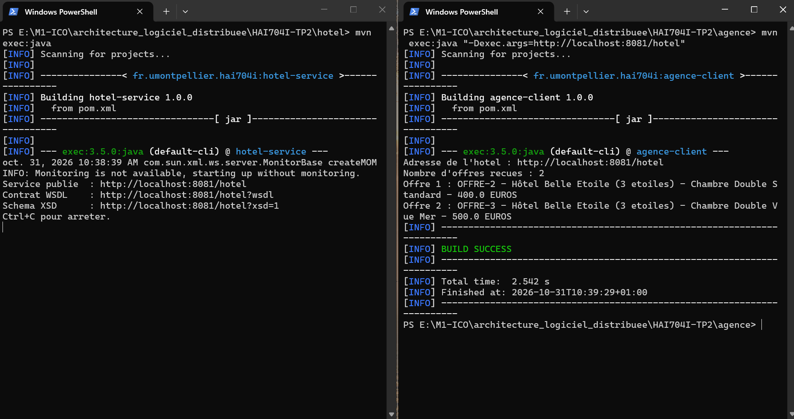
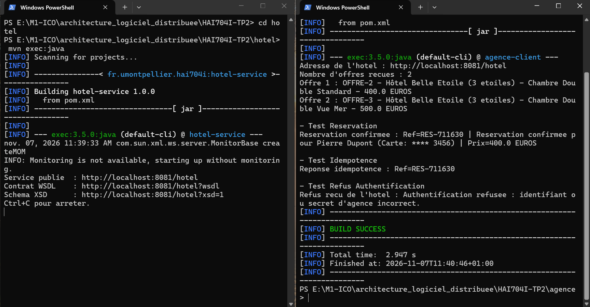
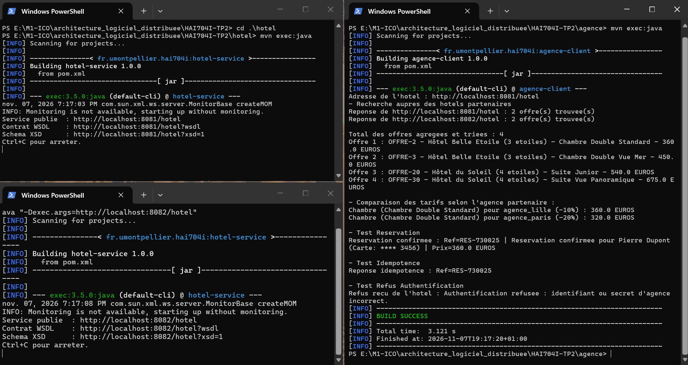
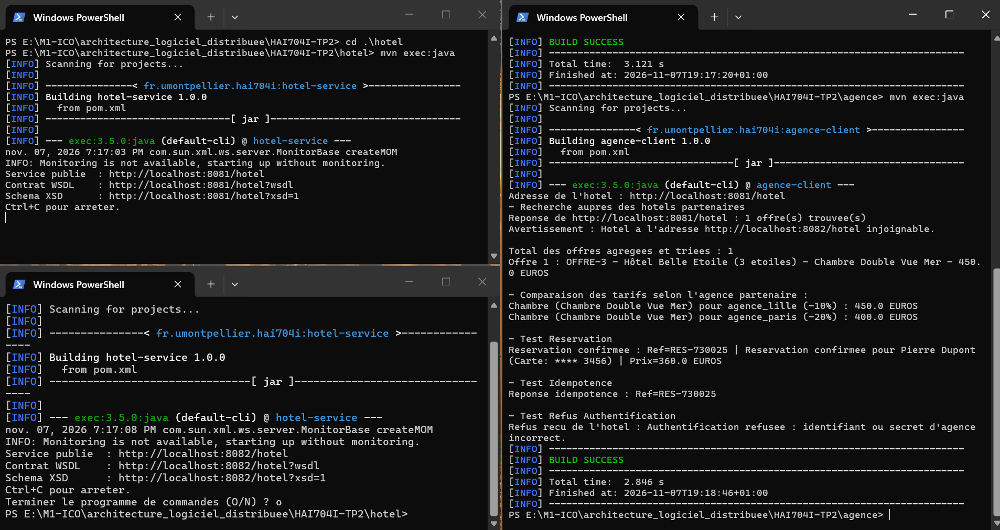
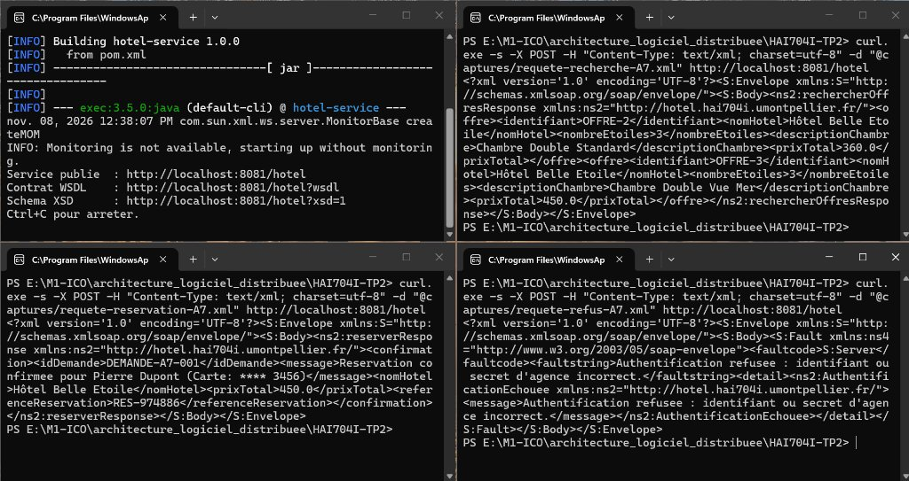
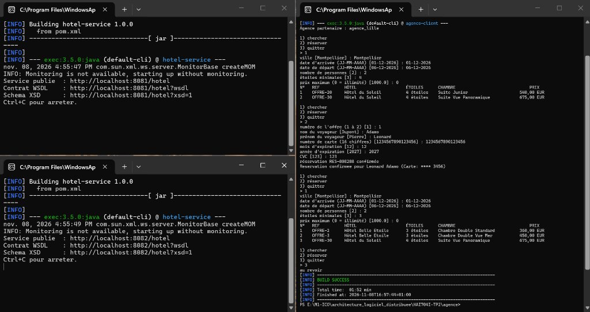

# HAI704I - TP 2 : Services web SOAP (Système de réservation d'hôtels)

**Université de Montpellier** - Master 1 Informatique (Parcours ICO)  
**UE HAI704I** : Architectures Logicielles Distribuées  
**Enseignant responsable** : Bachar Rima  
**Auteur** : Léonard ADAMO  
**Numéro étudiant** : 22517746
**Dépôt GitHub** : [https://github.com/Juste-Leo2/HAI704I-TP2](https://github.com/Juste-Leo2/HAI704I-TP2)  


## 1. Introduction

Pour le moment, ce TP est en cours de construction.

## A0

Pour commencer, j'ai mis en place A0 pour setup l'environnement de travail. voir [tuto](tuto.md)
Résultat : voir 


## A1

Pour effectuer le travail, je me suis basé sur l'exemple complet service employé démo présent sur Moodle

```text
HAI704I-TP2/

├── rapport/
│   └── resume.md
├── captures/
│   └── ___.txt            
│
├── hotel/
│   ├── pom.xml
│   └── src/main/java/hai704i/hotel/
│       ├── Serveur.java
│       ├── contrat/
│       │   ├── HotelPort.java
│       │   ├── dto/
│       │   │   ├── package-info.java
│       │   │   ├── DemandeRecherche.java
│       │   │   └── OffreDTO.java
│       │   └── faute/
│       │       ├── package-info.java
│       │       └── AgenceNonReconnue.java
│       ├── domaine/
│       │   ├── Chambre.java
│       │   └── Offre.java
│       ├── depot/
│       │   ├── HotelDepot.java
│       │   └── HotelDepotMemoire.java
│       ├── service/
│       │   └── ServiceHotel.java
│       └── endpoint/
│           └── HotelEndpoint.java
│
└── agence/
    ├── pom.xml
    └── src/main/java/hai704i/agence/
        ├── application/
        │   └── AgenceApplication.java
        └── cli/
            └── ConsoleAgence.java

```

A titre de comparaison, voilà l'arborescence reprise de l'exemple employé-demo sur Moodle(adapté pour mettre uniquement les fichier comparatif) :

```text
employe-demo/
  captures/                                         sorties réellement enregistrées (A7)
  client/                                           PROJET CLIENT SÉPARÉ
    src/main/
      java/hai704i/employe/client/
        application/                                LOGIQUE : seule à connaître SOAP
          AnnuaireEmployes.java
        cli/                                        INTERFACE CONSOLE (aucun import SOAP)
          ConsoleEmploye.java
      wsdl/
        employes.wsdl                               copie locale du contrat
    pom.xml                                         wsimport ; aucune dépendance au service
  service/                                          SERVICE WEB
    src/main/java/hai704i/employe/
      contrat/                                      CE QUI EST PUBLIÉ
        dto/                                        types de transfert
          DemandeCreation.java
          Employe.java
          package-info.java                         espace de noms déclaré
        faute/                                      les refus déclarés
          DonneesInvalides.java
          EmployeAbsent.java
          package-info.java
        EmployePort.java                            interface @WebService
      domaine/                                      MODÈLE MÉTIER (sans annotation SOAP)
        EmployeMetier.java
      depot/                                        FRONTIÈRE DE PERSISTANCE
        EmployeDepot.java                           interface du dépôt
      service/                                      RÈGLES MÉTIER (ignore SOAP)
        ServiceEmploye.java
      endpoint/                                     ADAPTATEUR SOAP (traduit, délègue)
        EmployeEndpoint.java
    pom.xml                                         dépendance jaxws-rt
```

Cette étape a permis de définir notre hôtel, les données qu'il peut recevoir ainsi que la publication du contrat sur le réseau :

- Serveur : ouvre le port HTTP et publie le service SOAP via Endpoint.publish.
- contrat/HotelPort : interface du contrat SOAP définissant l'opération de recherche exposée.
- contrat/dto : objets de transfert décrivant les données qui voyagent sur le réseau (DemandeRecherche, OffreDTO).
- endpoint (HotelEndpoint) : point d'accès qui implémente le contrat, traite les requêtes reçues et renvoie les réponses.

Résultat : voir 

## A2

Cette étape sépare explicitement les responsabilités de l'hôtel en 3 couches (Point d'accès, Service métier, Dépôt) :

- domaine (Chambre, Offre) : modèle métier interne de l'hôtel (records Java purs, sans aucune annotation).
- depot (HotelDepot, HotelDepotMemoire) : interface et implémentation en mémoire pour stocker et filtrer les chambres.
- service (ServiceHotel) : règles métier (calcul des prix, durée du séjour selon les dates, vérification ville et étoiles), sans dépendance à JAX-WS.
- endpoint (HotelEndpoint) : adaptateur qui reçoit la demande, appelle le service métier et traduit le résultat en DTO.

Le contrat WSDL reste strictement identique à l'étape A1, prouvant l'indépendance entre le contrat public et la mise en œuvre interne.

Résultat : voir 

## A3

Cette étape permet à l'hôtel de refuser explicitement une agence qui n'est pas partenaire, au lieu de renvoyer une liste vide trompeuse :

- contrat/faute/AgenceNonReconnue : exception métier déclarée avec @WebFault qui apparaît directement dans le WSDL.
- contrat/dto/DemandeRecherche : ajout de l'identifiant de l'agence pour savoir qui interroge l'hôtel.
- service/ServiceHotel : liste des agences autorisées et méthode de vérification.
- endpoint/HotelEndpoint : renvoie une faute SOAP 500 avec le détail précis de l'erreur si l'agence est inconnue.

Résultat : voir 


## A4

Cette étape crée le projet client agence qui interroge l'hôtel via SOAP :

- Client indépendant : Le projet agence ne dépend d'aucun code du projet hotel. Maven utilise l'outil wsimport pour générer automatiquement le proxy et les classes de données à partir du contrat WSDL (pour cela nous avons repris les fichiers .wsdl et .xsd créés par le service hôtel pour les passer à l'agence).
- Adresse de l'hôtel configurable en argument : L'URL du service n'est pas figée dans le code. On peut la passer directement au lancement avec `-Dexec.args="http://localhost:8081/hotel"` pour viser n'importe quel hôtel ou port.
- Récupération des offres : L'agence envoie ses critères de recherche, contacte l'hôtel et affiche les offres reçues.

Résultat : voir 


## A5

Cette étape ajoute l'opération de réservation (écriture) avec authentification, gestion du rejeu et protection des données sensibles :

Côté hôtel :
- Ajout de l'opération de réservation dans le contrat, regroupant les informations du voyageur et des coordonnées bancaires fictives.
- Authentification de l'agence par mot de passe (vérifié via une empreinte salée côté hôtel) avec refus explicite si le mot de passe est incorrect.
- Gestion du rejeu (idempotence) : si une demande avec le même identifiant est renvoyée, l'hôtel renvoie la réservation existante sans créer de doublon.
- Protection des données sensibles : aucun CVC n'est stocké en mémoire et le numéro de carte bancaire est masqué (ex: `**** 3456`). Le prix confirmé correspond exactement au prix annoncé.

Mise à jour du contrat pour l'agence :
Comme le contrat de l'hôtel a été modifié, nous avons mis à jour les fichiers WSDL et XSD locaux de l'agence :
```powershell
curl.exe -s "http://localhost:8081/hotel?wsdl" -o "agence/src/main/wsdl/hotel.wsdl"
curl.exe -s "http://localhost:8081/hotel?xsd=1" -o "agence/src/main/wsdl/hotel.xsd"
```
- Note : curl.exe pour windows, curl pour linux

Puis relancé `mvn compile` dans le dossier agence pour que wsimport engendre les nouvelles classes.

Côté client (agence) :
- Réservation de la première offre trouvée avec des coordonnées bancaires fictives et le secret de l'agence.
- Test d'idempotence : renvoi immédiat de la même demande pour vérifier qu'aucune seconde réservation n'est créée.
- Test de sécurité : tentative de réservation avec un mot de passe erroné pour vérifier la réception du refus envoyé par l'hôtel.

Résultat : voir 


## A6

Cette étape gère l'interrogation de plusieurs hôtels partenaires, l'application de tarifs négociés par agence, l'agrégation avec tri par prix, et la résilience aux défaillances partielles :

Côté hôtel :
- Support multi-instances : l'adresse de publication et le port peuvent être spécifiés au lancement de Serveur.java, permettant de déployer plusieurs hôtels distincts (ex: Hôtel Belle Étoile sur le port 8081 et Hôtel du Soleil sur le port 8082 avec des chambres et étoiles différentes).
- Tarification négociée : le calcul du prix prend en compte le partenariat avec chaque agence en appliquant un pourcentage de remise spécifique selon l'identifiant de l'agence (ex: -10% pour agence_lille, -20% pour agence_paris).

Côté client (agence) :
- Interrogation multi-hôtels : l'agence contacte successivement sa liste d'hôtels partenaires configurés (adressesHotels).
- Agrégation et tri : toutes les offres reçues sont regroupées dans une liste unique et triées par ordre de prix croissant.
- Vérification de la tarification personnalisée : comparaison pour une même chambre entre agences partenaires (ex: agence_lille avec -10% vs agence_paris avec -20%).
- Résilience aux pannes (défaillance partielle) : si l'un des hôtels partenaires est indisponible ou éteint, l'exception réseau (WebServiceException) est interceptée. L'agence affiche un avertissement d'une ligne et continue de fonctionner normalement avec les offres des autres hôtels disponibles.

Résultats :
- Tous les hôtels en ligne (4 offres agrégées et triées par prix) : voir 
- Un hôtel éteint (avertissement de panne sans crash, offre occupée exclue) : voir 


## A7

Cette étape permet de vérifier ce qui transite réellement sur le réseau ("sur le fil") à l'aide de requêtes XML manuelles envoyées avec curl.exe (fichiers stockés dans le dossier `captures/`) :

- captures/requete-recherche-A7.xml et captures/reponse-recherche-A7.xml : requête de recherche envoyée à l'hôtel et sa réponse contenant la liste des offres en XML (HTTP 200).
- captures/requete-reservation-A7.xml et captures/reponse-reservation-A7.xml : requête de réservation avec voyageur et carte bancaire, et sa confirmation avec le numéro de référence (HTTP 200).
- captures/requete-refus-A7.xml et captures/reponse-refus-A7.xml : requête de réservation avec un mot de passe d'agence incorrect, provoquant un refus explicite sous la forme d'une faute SOAP structurée (HTTP 500 et balise `<S:Fault>`).

Ces captures permettent de vérifier les éléments du contrat :
- Version SOAP : SOAP 1.1, identifiée par l'espace de noms `http://schemas.xmlsoap.org/soap/envelope/` et l'élément racine `<S:Envelope>`.
- Suivi d'une valeur (prixTotal) : déclarée en double dans OffreDTO (Java hôtel), traduite en `xs:double` dans le schéma XSD, transmise en texte dans la balise `<prixTotal>` sur le réseau, puis convertie en double dans la classe générée côté agence.
- Indépendance des classes : l'agence ne partage aucune classe avec l'hôtel, elle instancie ses propres objets à partir du flux XML reçu.
- Sécurité sur le fil : le CVC n'est jamais renvoyé et le numéro de carte bancaire est masqué dans la réponse.
- Note sur l'encodage sous Windows : Windows PowerShell 5.1 interprète et redirige par défaut les flux sans BOM en Windows-1252 (ce qui altère les accents UTF-8 comme dans "Hôtel"). L'utilisation de PowerShell 7+ (`pwsh`) résout ce problème en adoptant UTF-8 comme encodage natif par défaut.

Résultat : voir 


## A8

Cette étape dote l'agence d'une interface en ligne de commande interactive (CLI) respectant la stricte séparation en couches :

- ConsoleAgence (couche CLI) : interface interactive sans aucun import SOAP (`jakarta.xml.ws` ou `hai704i.hotel.engendre`), proposant un menu épuré (chercher, réserver, quitter) avec saisie de valeurs par défaut.
- LogiqueAgence (couche logique d'agence) : seule classe connaissant SOAP, interrogeant les différents hôtels partenaires, agrégeant et triant les offres par prix, et capturant les fautes du contrat.
- OffreVue et ResultatReservation (modèle client) : records Java purs encapsulant les données pour l'affichage sans faire fuiter d'exception SOAP vers la console.
- Sécurité : le numéro de carte bancaire est masqué dans la confirmation (`**** 3456`) et le code CVC n'est jamais réaffiché ni conservé.

Résultat : voir 


## 7. Licence

Ce projet est distribué sous licence **Apache 2.0**. Consultez le fichier [LICENSE](LICENSE) pour plus de détails.