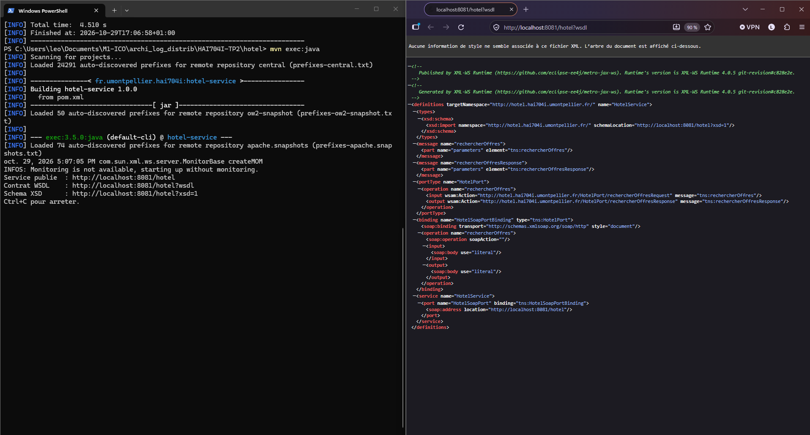
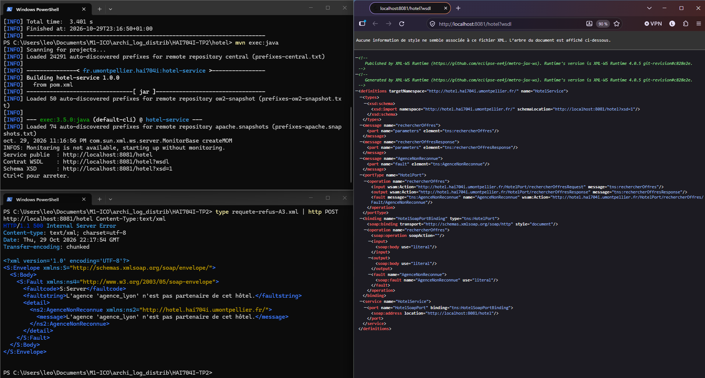

# HAI704I - TP 2 : Services web SOAP (Système de réservation d'hôtels)

**Université de Montpellier** - Master 1 Informatique (Parcours ICO)  
**UE HAI704I** : Architectures Logicielles Distribuées  
**Enseignant responsable** : Bachar Rima  
**Auteur** : Léonard ADAMO  
**Numéro étudiant** : 22517746
**Dépôt GitHub** : [https://github.com/Juste-Leo2/HAI704I-TP2](https://github.com/Juste-Leo2/HAI704I-TP2)  


## 1. Introduction

Pour le moment, ce TP est en cours de construction.

## A0

Pour commencer, j'ai mis en place A0 pour setup l'environnement de travail. voir [tuto](tuto.md)
Résultat : voir 


## A1

Pour effectuer le travail, je me suis basé sur l'exemple complet service employé démo présent sur Moodle

```text
HAI704I-TP2/

├── rapport/
│   └── resume.md
├── captures/
│   └── ___.txt            
│
├── hotel/
│   ├── pom.xml
│   └── src/main/java/hai704i/hotel/
│       ├── Serveur.java
│       ├── contrat/
│       │   ├── HotelPort.java
│       │   ├── dto/
│       │   │   ├── package-info.java
│       │   │   ├── DemandeRecherche.java
│       │   │   └── OffreDTO.java
│       │   └── faute/
│       │       ├── package-info.java
│       │       └── AgenceNonReconnue.java
│       ├── domaine/
│       │   ├── Chambre.java
│       │   └── Offre.java
│       ├── depot/
│       │   ├── HotelDepot.java
│       │   └── HotelDepotMemoire.java
│       ├── service/
│       │   └── ServiceHotel.java
│       └── endpoint/
│           └── HotelEndpoint.java
│
└── agence/
    ├── pom.xml
    └── src/main/java/hai704i/agence/
        ├── application/
        │   └── AgenceApplication.java
        └── cli/
            └── ConsoleAgence.java

```

A titre de comparaison, voilà l'arborescence reprise de l'exemple employé-demo sur Moodle(adapté pour mettre uniquement les fichier comparatif) :

```text
employe-demo/
  captures/                                         sorties réellement enregistrées (A7)
  client/                                           PROJET CLIENT SÉPARÉ
    src/main/
      java/hai704i/employe/client/
        application/                                LOGIQUE : seule à connaître SOAP
          AnnuaireEmployes.java
        cli/                                        INTERFACE CONSOLE (aucun import SOAP)
          ConsoleEmploye.java
      wsdl/
        employes.wsdl                               copie locale du contrat
    pom.xml                                         wsimport ; aucune dépendance au service
  service/                                          SERVICE WEB
    src/main/java/hai704i/employe/
      contrat/                                      CE QUI EST PUBLIÉ
        dto/                                        types de transfert
          DemandeCreation.java
          Employe.java
          package-info.java                         espace de noms déclaré
        faute/                                      les refus déclarés
          DonneesInvalides.java
          EmployeAbsent.java
          package-info.java
        EmployePort.java                            interface @WebService
      domaine/                                      MODÈLE MÉTIER (sans annotation SOAP)
        EmployeMetier.java
      depot/                                        FRONTIÈRE DE PERSISTANCE
        EmployeDepot.java                           interface du dépôt
      service/                                      RÈGLES MÉTIER (ignore SOAP)
        ServiceEmploye.java
      endpoint/                                     ADAPTATEUR SOAP (traduit, délègue)
        EmployeEndpoint.java
    pom.xml                                         dépendance jaxws-rt
```

Cette étape a permis de définir notre hôtel, les données qu'il peut recevoir ainsi que la publication du contrat sur le réseau :

- Serveur : ouvre le port HTTP et publie le service SOAP via Endpoint.publish.
- contrat/HotelPort : interface du contrat SOAP définissant l'opération de recherche exposée.
- contrat/dto : objets de transfert décrivant les données qui voyagent sur le réseau (DemandeRecherche, OffreDTO).
- endpoint (HotelEndpoint) : point d'accès qui implémente le contrat, traite les requêtes reçues et renvoie les réponses.

Résultat : voir 

## A2

Cette étape sépare explicitement les responsabilités de l'hôtel en 3 couches (Point d'accès, Service métier, Dépôt) :

- domaine (Chambre, Offre) : modèle métier interne de l'hôtel (records Java purs, sans aucune annotation).
- depot (HotelDepot, HotelDepotMemoire) : interface et implémentation en mémoire pour stocker et filtrer les chambres.
- service (ServiceHotel) : règles métier (calcul des prix, durée du séjour selon les dates, vérification ville et étoiles), sans dépendance à JAX-WS.
- endpoint (HotelEndpoint) : adaptateur qui reçoit la demande, appelle le service métier et traduit le résultat en DTO.

Le contrat WSDL reste strictement identique à l'étape A1, prouvant l'indépendance entre le contrat public et la mise en œuvre interne.

Résultat : voir 

## A3

Cette étape permet à l'hôtel de refuser explicitement une agence qui n'est pas partenaire, au lieu de renvoyer une liste vide trompeuse :

- contrat/faute/AgenceNonReconnue : exception métier déclarée avec @WebFault qui apparaît directement dans le WSDL.
- contrat/dto/DemandeRecherche : ajout de l'identifiant de l'agence pour savoir qui interroge l'hôtel.
- service/ServiceHotel : liste des agences autorisées et méthode de vérification.
- endpoint/HotelEndpoint : renvoie une faute SOAP 500 avec le détail précis de l'erreur si l'agence est inconnue.

Résultat : voir 


## A4

Cette étape crée le projet client agence qui interroge l'hôtel via SOAP :

- Client indépendant : Le projet agence ne dépend d'aucun code du projet hotel. Maven utilise l'outil wsimport pour générer automatiquement le proxy et les classes de données à partir du contrat WSDL (pour cela nous avons repris les fichiers .wsdl et .xsd créés par le service hôtel pour les passer à l'agence).
- Adresse de l'hôtel configurable en argument : L'URL du service n'est pas figée dans le code. On peut la passer directement au lancement avec `-Dexec.args="http://localhost:8081/hotel"` pour viser n'importe quel hôtel ou port.
- Récupération des offres : L'agence envoie ses critères de recherche, contacte l'hôtel et affiche les offres reçues.

Résultat : voir 


## 7. Licence

Ce projet est distribué sous licence **Apache 2.0**. Consultez le fichier [LICENSE](LICENSE) pour plus de détails.