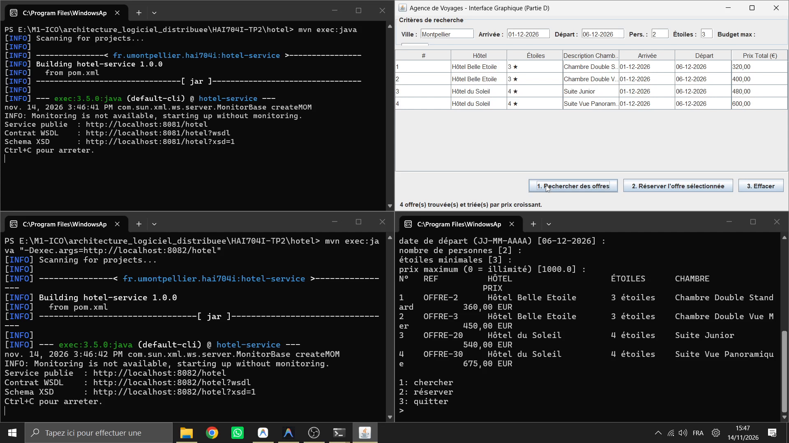

> [!WARNING]
> This is a student project. The code is not intended for production use.
> It is provided under the Apache 2.0 license. The documentation is in French.

# HAI704I - TP 2 : Services Web SOAP (Système de Réservation d'Hôtels Distribué)

**Université de Montpellier** - Master 1 Informatique (Parcours ICO)  
**UE HAI704I** : Architectures Logicielles Distribuées  
**Enseignant responsable** : Bachar Rima  
**Auteur** : Léonard ADAMO  
**Numéro étudiant** : 22517746  
**Dépôt GitHub** : [https://github.com/Juste-Leo2/HAI704I-TP2](https://github.com/Juste-Leo2/HAI704I-TP2)  

---

## 1. Démonstration

Une vidéo complète de démonstration multi-processus (Serveurs Hôtels, Client CLI et Client Graphique Swing) est incluse directement dans le projet :

[](video/demonstration.mp4)

- **[Cliquez ici pour visionner la vidéo de démonstration (demonstration.mp4)](video/demonstration.mp4)**  
*(Également consultable en ligne sur GitHub : [video/demonstration.mp4](https://github.com/Juste-Leo2/HAI704I-TP2/blob/main/video/demonstration.mp4))*

---

## 2. Installation de l'Environnement (Java 17 & Maven)

Le projet nécessite **Java 17 (JDK 17)** et **Maven 3.9+**.

### 2.1. JDK 17

#### Sous Windows :
1. Télécharger l'installateur Windows x64 (`.exe`) :  
   [Oracle JDK 17 Archive Downloads](https://www.oracle.com/java/technologies/javase/jdk17-0-13-later-archive-downloads.html)
2. Lancer l'installation par défaut.
3. Vérifier les variables d'environnement système :
   - `JAVA_HOME` : `C:\Program Files\Java\jdk-17`
   - `Path` : placer `C:\Program Files\Java\jdk-17\bin` en tête de liste.

#### Sous Linux (Ubuntu / Debian) :
```bash
sudo apt update
sudo apt install -y openjdk-17-jdk
```

### 2.2. Maven et HTTPie / curl

#### Sous Windows (via Chocolatey) :
```cmd
choco install maven httpie -y
```

#### Sous Linux :
```bash
sudo apt install -y maven httpie curl
```

### 2.3. Vérification de l'installation :
```bash
# Vérification de Java et de Maven
javac --version
mvn --version

# Vérification de curl (utiliser curl.exe sous Windows PowerShell)
curl --version      # Linux / macOS / CMD
curl.exe --version  # Windows PowerShell
```

### 2.4. Environnement de Développement
- **IDE utilisé :** [Antigravity IDE](https://antigravity.google/product/antigravity-ide/)

> **Note importante pour Windows PowerShell :**  
> - **Windows PowerShell 5.1 (par défaut sous Windows) :** La commande `curl` est un alias natif vers l'applet `Invoke-WebRequest`. Pour appeler le véritable utilitaire cURL, il faut impérativement taper **`curl.exe`**. De plus, les redirections de flux y sont par défaut en Windows-1252 (ce qui altère les accents UTF-8).  
> - **PowerShell 7+ (`pwsh`) :** Cet alias a été retiré, la commande standard **`curl`** appelle directement le bon binaire et l'encodage **UTF-8 natif** est supporté par défaut (recommandé pour préserver les caractères accentués).  
> - **Linux / macOS / CMD :** La commande standard reste `curl`.

---

## 3. Architecture et Rôle des Modules

Le projet est découpé en deux modules principaux (`hotel` et `agence`), accompagnés des captures réseau et du rapport :

- **`hotel/`** : Service web SOAP (serveur) développé avec Jakarta XML Web Services, structuré en 3 couches (Adaptateur JAX-WS, Service métier pur et Dépôt en mémoire).
- **`agence/`** : Client SOAP indépendant de l'hôtel. Utilise les classes générées par `wsimport` à partir du WSDL local et propose deux interfaces (Console CLI et Graphique Swing).
- **`captures/`** : Fichiers XML des requêtes et réponses envoyées (Étapes A3 et A7).
- **`video/`** : Vidéo de démonstration du projet.

```text
HAI704I-TP2/
├── hotel/                                       # Service Web SOAP (Hôtel)
│   ├── pom.xml                                  # Dépendance jaxws-rt
│   └── src/main/java/hai704i/hotel/
│       ├── Serveur.java                         # Point d'entrée
│       ├── contrat/                             # Contrat SOAP exposé
│       │   ├── HotelPort.java                   # Interface @WebService
│       │   ├── dto/                             # Objets de transfert (JAXB)
│       │   │   ├── CarteBancaireDTO.java
│       │   │   ├── ClientDTO.java
│       │   │   ├── ConfirmationReservationDTO.java
│       │   │   ├── DemandeRecherche.java
│       │   │   ├── DemandeReservation.java
│       │   │   ├── OffreDTO.java
│       │   │   └── package-info.java
│       │   └── faute/                           # Fautes SOAP déclarées (@WebFault)
│       │       ├── AgenceNonReconnue.java
│       │       ├── AuthentificationEchouee.java
│       │       ├── OffreIndisponible.java
│       │       ├── PaiementInvalide.java
│       │       └── package-info.java
│       ├── domaine/                             # Modèle métier interne (records Java purs)
│       │   ├── Chambre.java
│       │   ├── Offre.java
│       │   └── Reservation.java
│       ├── depot/                               # Couche de persistance
│       │   ├── HotelDepot.java
│       │   └── HotelDepotMemoire.java           # Stockage des chambres en mémoire
│       ├── service/
│       │   └── ServiceHotel.java
│       └── endpoint/
│           └── HotelEndpoint.java
│
├── agence/                                      # Client SOAP
│   ├── pom.xml
│   └── src/main/
│       ├── wsdl/                                # Copie locale du contrat WSDL/XSD
│       │   ├── hotel.wsdl
│       │   └── hotel.xsd
│       └── java/hai704i/agence/
│           ├── application/                     # Orchestration et logique SOAP
│           │   ├── AgenceApplication.java       # Tests A4 à A7
│           │   ├── ClientHotel.java             # Proxy JAX-WS et URL dynamique
│           │   ├── LogiqueAgence.java           # Gestion multi-hôtels et résilience
│           │   ├── OffreVue.java
│           │   └── ResultatReservation.java
│           ├── cli/                             # Interface console
│           │   └── ConsoleAgence.java
│           └── gui/                             # Interface graphique Swing
│               └── SwingUI.java
│
├── captures/                                    # Requêtes et réponses XML manuelles (A3 et A7)
│   ├── requete-refus-A3.xml
│   ├── reponse-refus-A3.xml
│   ├── requete-recherche-A7.xml
│   ├── reponse-recherche-A7.xml
│   ├── requete-reservation-A7.xml
│   ├── reponse-reservation-A7.xml
│   ├── requete-refus-A7.xml
│   └── reponse-refus-A7.xml
└── video/                                       # Démonstration vidéo
```

---

## 4. Compilation

La compilation s'effectue via Maven :

```bash
# 1. Compiler le service Hôtel
cd hotel
mvn clean compile

# 2. Compiler l'Agence (génère les classes proxy via wsimport)
cd ../agence
mvn clean compile
```

---

## 5. Démarrage et Exécution

### 5.1. Jeu de Données de Démonstration (Fictif)
Pour faciliter les tests lors de l'évaluation, l'ensemble des formulaires et saisies (CLI et GUI Swing) est pré-rempli avec des valeurs par défaut valides : il suffit d'appuyer sur la touche [Entrée] à chaque champ pour dérouler un scénario nominal complet.

- Ville couverte : `Montpellier` (dates par défaut : du `01-12-2026` au `06-12-2026`).
- Hôtels configurés :
  - Hôtel 1 (Port 8081) : *Hôtel Belle Étoile* (3 étoiles) : Chambre simple 101 (80 €/nuit), Chambre double 102 (120 €/nuit), Suite 103 (200 €/nuit).
  - Hôtel 2 (Port 8082) : *Hôtel du Soleil* (4 étoiles) : Chambre double confort 201 (140 €/nuit), Suite vue mer 202 (250 €/nuit).
- Agences partenaires et secrets :
  - `agence_lille` : secret `secret_lille_123` (remise négociée de 10%).
  - `agence_paris` : secret `secret_paris_456` (remise négociée de 20%).
  - Configuration : Le secret et l'identifiant se configurent en argument de lancement de la CLI (`mvn exec:java -Dexec.args="agence_lille secret_lille_123"`), ou par défaut dans `ConsoleAgence.java`.
- Coordonnées bancaires de test : Numéro `1234567890123456`, expiration `12/2027`, CVC `123`.

### 5.2. Lancement des Processus

Lancer les processus dans l'ordre suivant dans des terminaux distincts :

### 1. Démarrer le Premier Hôtel (Hôtel Belle Étoile - Port 8081)
Dans un premier terminal :
```bash
cd hotel
mvn exec:java
```
Le service écoute sur `http://localhost:8081/hotel` et son WSDL est disponible sur `http://localhost:8081/hotel?wsdl`.

### 2. Démarrer le Second Hôtel (Hôtel du Soleil - Port 8082, Multi-instances)
Dans un second terminal :
```bash
cd hotel
mvn exec:java -Dexec.args="http://localhost:8082/hotel"
```
Le second hôtel écoute sur le port 8082 avec ses propres chambres et tarifs.

### 3. Démarrer le Client Console (CLI - Étape A8)
Dans un troisième terminal :
```bash
cd agence
mvn exec:java
```
L'interface CLI propose un menu interactif pour rechercher des offres, comparer les prix entre hôtels partenaires, et réserver un séjour avec saisie sécurisée.

### 4. (Bonus) Démarrer l'Interface Graphique (GUI Swing - Partie D)
Dans un terminal :
```bash
cd agence
mvn exec:java -Dexec.mainClass="hai704i.agence.gui.SwingUI"
```

### 5. Exécuter le Scénario de Tests (Étapes A4 à A7)
Pour rejouer la séquence complète de tests automatisés :
```bash
cd agence
mvn exec:java -Dexec.mainClass="hai704i.agence.application.AgenceApplication"
```

---

## 6. Arrêt Propre

- **Client CLI** : saisir `0` dans le menu pour quitter proprement.
- **Client Graphique Swing** : fermer la fenêtre (croix rouge).
- **Serveurs Hôtels** : arrêt via `Ctrl + C` dans leurs terminaux respectifs.

---

## 7. Licence

Ce projet est distribué sous licence **Apache 2.0**. Consultez le fichier [LICENSE](LICENSE) pour plus de détails.
